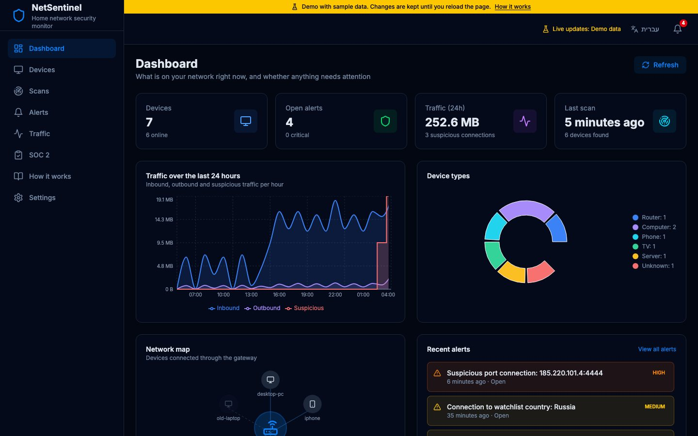
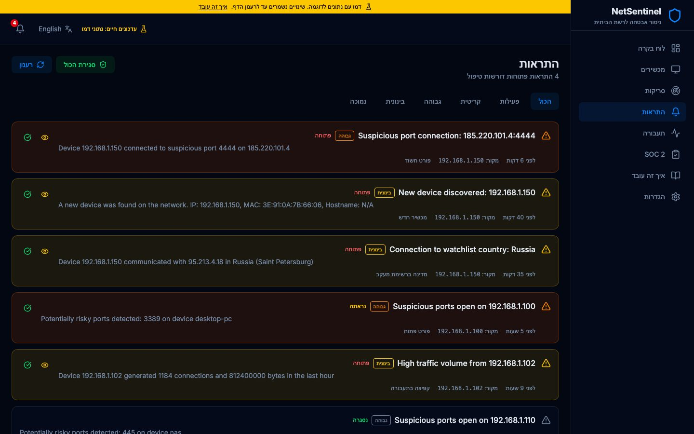
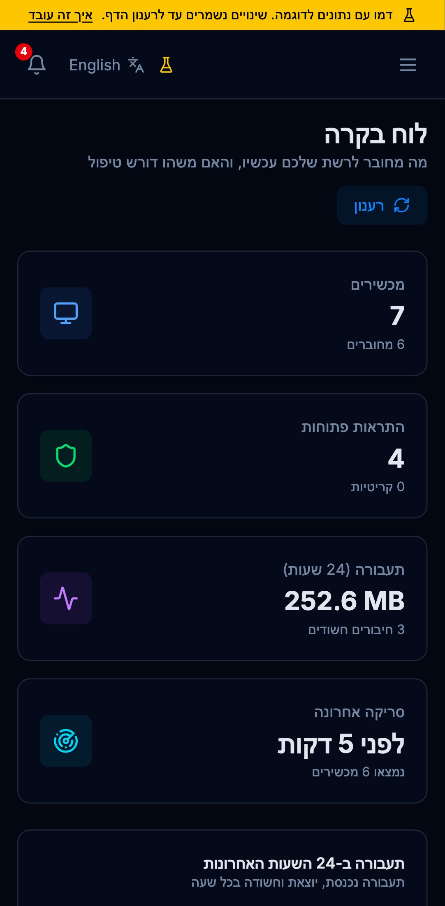

# NetSentinel

[](https://github.com/SaharHalili95/netsentinel/actions/workflows/ci.yml)

**[Live demo](https://saharhalili95.github.io/netsentinel/)** · Python · FastAPI · PostgreSQL · Redis · WebSocket · nmap · Scapy · Next.js · TypeScript · Playwright · Docker

Most people can't answer two simple questions about their home network: *what is connected to it right now*, and *is any of it doing something it shouldn't*. Routers show a list of MAC addresses at best.

NetSentinel answers both. It discovers every device, scans their open ports, samples where they connect, and raises an alert when something looks wrong: a new unknown device, a connection to a port used by reverse shells, traffic to a watchlist country, or a sudden traffic spike. It also keeps daily SOC 2 style evidence (alerts reviewed, backups verified, and so on).

| Dashboard | Alerts in Hebrew (RTL) | Mobile |
| --- | --- | --- |
|  |  |  |

The live demo is the real Next.js app, exported as static files, with a sample home network loaded in the browser. Scanning a real network needs nmap and root on a local machine, so that part runs only in a local install.

## What it does

- **Device discovery:** ARP and nmap find devices, with MAC vendor and hostname. A device seen for the first time creates an alert.
- **Port scanning:** common ports per device. Risky services (Telnet, SMB, RDP, VNC and others) create an alert. Each device row expands to show its open ports.
- **Traffic analysis:** Scapy samples connections and GeoIP adds country and city. The traffic page shows protocols, top destinations, traffic by country and suspicious connections from `GET /api/traffic/summary`.
- **Anomaly rules:**

  | Rule | Severity | Trigger |
  | --- | --- | --- |
  | Suspicious port | High | Connection to 23, 135, 139, 445, 1433, 3389, 4444, 5900, 6667, 8888 or 31337 |
  | Watchlist country | Medium | Traffic to Russia, China, North Korea or Iran |
  | Traffic spike | Medium | More than 1,000 connections from one device in an hour |
  | New device | Medium | A MAC address not seen before |
  | Risky open port | High | 23, 135, 139, 445, 3389 or 5900 open on a device |

- **Alerts:** open, then acknowledged, then resolved. New alerts are pushed over WebSocket and announced to screen readers.
- **SOC 2 daily checks:** six required checks mapped to CC6.1, CC7.1, CC7.2, CC7.3, A1.1 and A1.2, a daily score and 30 days of history.

## Built for everyone

- **English and Hebrew:** full right-to-left layout, dates, numbers and relative times in each language. IP addresses, MACs and ports stay left-to-right inside Hebrew text. A test fails if a key is missing in either language.
- **Accessible:**
  - a skip link and full keyboard navigation (tabs with arrow keys, menu closes with Escape and returns focus)
  - labels on every icon button
  - every chart has a caption and a screen-reader table of the same numbers
  - axe finds no WCAG 2.1 A/AA violations on any page, in either language, checked in CI
  - honors `prefers-reduced-motion`, with an extra switch in Settings
- **Mobile:** the sidebar becomes a drawer, wide tables scroll inside their card, and CI checks every page for horizontal overflow on iPhone and Android.
- **Honest about failures:** if the API is down, pages show an error with a retry button. If an action fails, the screen does not pretend it worked.

## Tests

| Suite | What it covers | Count |
| --- | --- | --- |
| pytest | anomaly rules, discovery XML parsing, port scanner, GeoIP, alerting, SOC 2 scoring, traffic summary, API key security | 76 |
| Vitest | demo API behavior, translations (key parity, RTL, persistence), formatters, the app shell (menu, skip link, alert badge), request races | 23 |
| Playwright | every page in both languages, axe accessibility, RTL, keyboard, trust/acknowledge/resolve/scan flows, on iPhone 14, Pixel 7 and desktop Chrome | 123 runs |

CI runs all three on every push, plus `pip-audit` and `npm audit`.

## Where the code is

| Part | Code |
| --- | --- |
| Scans and discovery | `backend/app/services/scanner.py`, `device_discovery.py`, `port_scanner.py` |
| Anomaly rules and alerts | `backend/app/services/anomaly_detector.py`, `alerting.py`, `backend/app/api/websocket.py` |
| Traffic summary | `backend/app/services/traffic_summary.py`, `backend/app/api/traffic.py` |
| SOC 2 checks | `backend/app/services/compliance.py`, `backend/app/models/compliance.py` |
| Scheduling | `backend/app/tasks/scheduler.py` (discovery every 5 min, port scan hourly, capture every 2 min) |
| API client and demo data | `frontend/src/lib/api/` (HTTP client and in-browser demo behind one interface), `frontend/src/lib/demo/` |
| Translations | `frontend/src/lib/i18n/` |
| Pages | `frontend/src/app/` |

## Running it

Requirements: Docker and Docker Compose, on Linux or macOS. Port scanning and ARP discovery need raw socket access (root, or Docker with `NET_RAW` and `NET_ADMIN`).

```bash
git clone https://github.com/SaharHalili95/netsentinel.git
cd netsentinel
cp .env.example .env
docker compose up --build
```

- App: http://localhost:3000
- API docs: http://localhost:8000/docs

The demo build runs without a backend:

```bash
cd frontend
npm ci
NEXT_PUBLIC_DEMO=1 npm run build   # static files in frontend/out
```

Tests:

```bash
cd backend && pip install -e ".[dev]" && pytest
cd frontend && npm test && npx playwright test
```

## API

| Method | Path | Description |
| --- | --- | --- |
| GET | `/api/dashboard` | Device, alert, scan and traffic totals, recent alerts |
| GET | `/api/devices` | Devices (`online_only` filter) |
| PATCH | `/api/devices/{id}` | Update trust or notes (API key) |
| GET, POST | `/api/scans` | Scan history, start a scan (API key) |
| GET | `/api/alerts` | Alerts (filter by status and severity) |
| PATCH | `/api/alerts/{id}` | Acknowledge or resolve |
| POST | `/api/alerts/resolve-all` | Resolve every open alert |
| GET | `/api/traffic/summary` | Protocols, destinations, countries, suspicious connections, hourly volume |
| GET | `/api/compliance/status`, `/history`, `/checks/required`, `/criteria` | SOC 2 daily checks |
| WS | `/api/ws/live` | Live alerts, scan and device updates |

## License

MIT
